# TP 3 : Serveur Multi-threads - Sockets TCP en mode connecté

Matière : Développement d'applications réparties
Auditoire : LSI 3, année universitaire 2026/2027
Enseignante des TPs : Zeineb DAOUD
Étudiant(e) : Nom Prénom

## 1. Objectif

Concevoir un serveur multi-thread basé sur les sockets TCP en Java, capable de traiter plusieurs clients simultanément.

- Activité 3-1 : acceptation de plusieurs clients et attribution d'un numéro d'ordre.
- Activité 3-2 : service de calculatrice multi-thread, communication par objets et compteur global synchronisé.

## 2. Structure du projet

```
TP3-DAR2026/
└── src/
    ├── clientPackage/
    │   ├── Client.java        (client activité 3-1)
    │   ├── Client2.java       (client calculatrice, objets)
    │   └── ClientTest.java    (test de charge, clients parallèles)
    ├── operationPackage/
    │   └── Operation.java     (objet sérialisable : a, opérateur, b)
    └── serverPackage/
        ├── Server.java        (serveur 3-1 + ClientProcess, port 1234)
        └── Server2.java       (serveur 3-2 + ClientProcess2, port 1235)
```

## 3. Exécution

1. Lancer Server (port 1234) et/ou Server2 (port 1235).
2. Lancer un ou plusieurs clients. Par défaut le serveur visé est localhost. Pour un serveur distant, passer son adresse IP en argument du programme (exemple : 192.168.1.15).
3. Pour lancer plusieurs instances dans IntelliJ : Edit Configurations, Modify options, Allow multiple instances.

## 4. Activité 3-1 : Acceptation de plusieurs clients

### 4.1 Principe

Le serveur exécute accept() dans une boucle infinie. À chaque connexion :

1. un numéro d'ordre est attribué au client ;
2. son adresse est affichée grâce à getRemoteSocketAddress() ;
3. un thread dédié (ClientProcess) est créé et démarré, ce qui libère aussitôt le serveur pour accepter le client suivant ;
4. le thread envoie au client son numéro, puis reste en écoute (écho des messages, fin avec quit ou à la déconnexion).

```java
while (true) {
    Socket socket = serverSocket.accept();
    numeroClient++;
    new ClientProcess(socket, numeroClient).start();
}
```

### 4.2 Tests locaux avec des clients Java

Serveur en attente des clients :

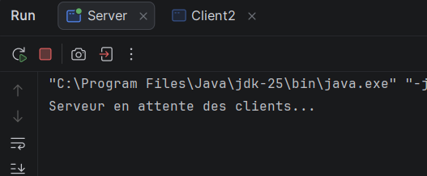

Client Java connecté (adresse construite avec InetAddress et InetSocketAddress) :

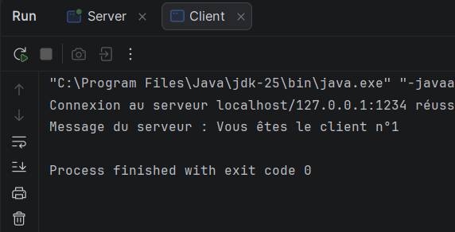

Console du serveur après trois clients (adresse IP, port et numéro d'ordre de chacun) :

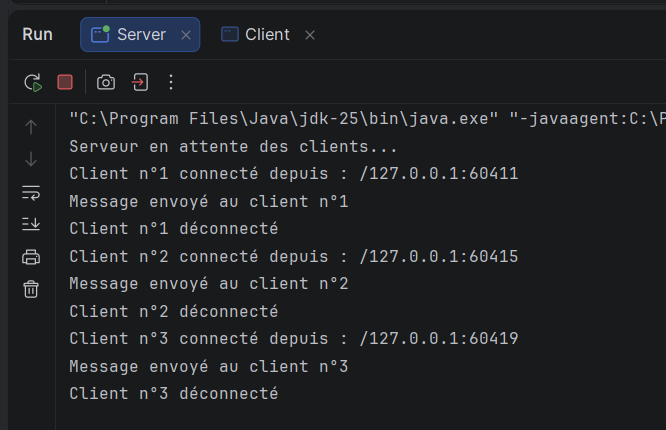

Client n°3 :

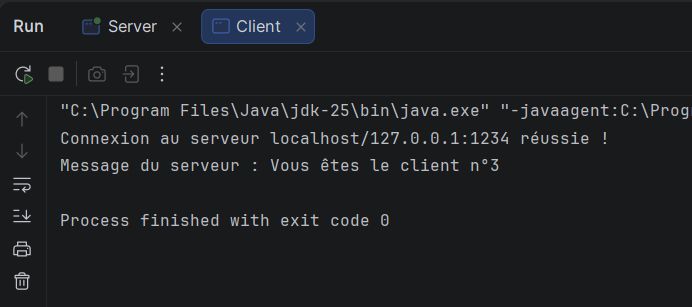

### 4.3 Tests locaux avec Telnet

Difficulté : Telnet n'est pas activé par défaut sous Windows.

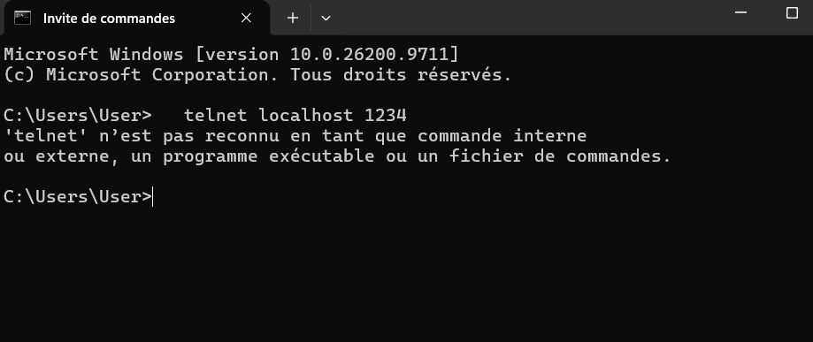

Solution : activer la fonctionnalité Client Telnet avec la commande suivante, exécutée dans une invite de commandes administrateur.

```
dism /online /Enable-Feature /FeatureName:TelnetClient
```

[Capture à insérer : activation réussie]

Premier test : la connexion fonctionne mais les caractères accentués sont mal affichés. Le serveur envoie de l'UTF-8 alors que la console Windows utilise un autre code page.

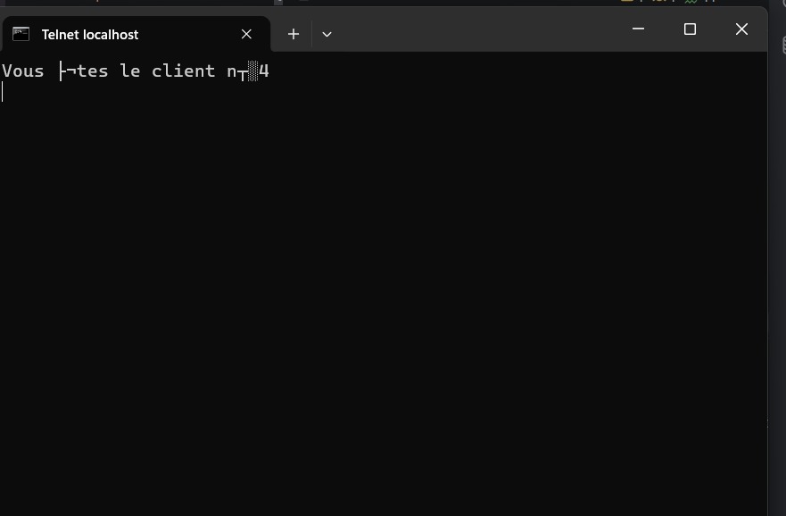

Solution : exécuter chcp 65001 avant la commande telnet localhost 1234.

[Capture à insérer : trois fenêtres Telnet ouvertes simultanément, chacune avec son numéro de client]

[Capture à insérer : console du serveur avec les trois connexions Telnet simultanées]

[Capture à insérer : échange d'un message (écho) puis quit]

### 4.4 Test en réseau local

Le client reçoit l'adresse IP du serveur en argument. Elle est convertie avec InetAddress.getByName() puis utilisée dans un InetSocketAddress.

[Capture à insérer : ipconfig sur la machine serveur]

[Capture à insérer : client sur la deuxième machine]

[Capture à insérer : console du serveur avec l'adresse IP de la deuxième machine]

### 4.5 Synthèse

Un serveur mono-thread traite un seul client à la fois, les autres attendent. En confiant chaque client à un Thread dédié, la boucle accept() reste toujours disponible et plusieurs clients sont servis en parallèle. Les tests avec plusieurs fenêtres Telnet ouvertes en même temps le démontrent, car la connexion reste active pendant toute la session. Le numéro d'ordre est attribué dans le thread principal, il n'y a donc aucun risque de conflit.

## 5. Activité 3-2 : Calculatrice multi-thread

### 5.1 Principe

- Le client envoie un objet Operation (sérialisable) avec un ObjectOutputStream.
- Le serveur crée un thread ClientProcess2 par client, calcule le résultat et renvoie une chaîne de caractères avec un ObjectOutputStream.
- Un client peut envoyer plusieurs opérations pendant la même session (la touche q termine la session).
- Les erreurs (division par zéro, opérateur invalide) sont signalées au client sans interrompre la session.

| Classe | Rôle |
|---|---|
| Operation | Objet sérialisable contenant a, operateur et b |
| Server2 | Accepte les connexions, démarre un thread par client, contient le compteur global |
| ClientProcess2 | Thread qui lit les opérations, calcule et répond |
| Client2 | Saisie utilisateur, envoi des opérations, affichage des réponses |
| ClientTest | Lance plusieurs clients en parallèle (test de charge) |

### 5.2 Tests locaux (première version, un client à la fois)

Serveur calculatrice en attente :

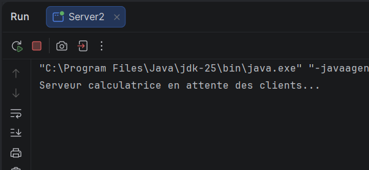

Client : 10 * 5 :

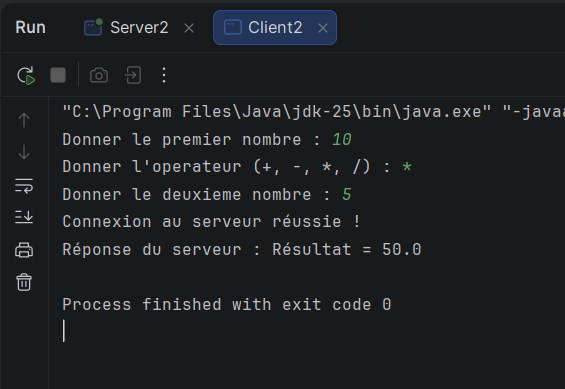

Console du serveur (opération n°1) :

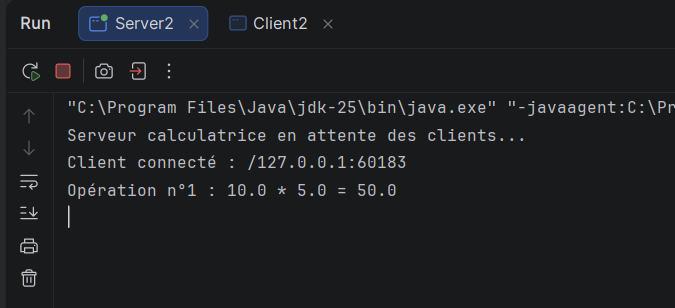

Client : 20 + 7 :

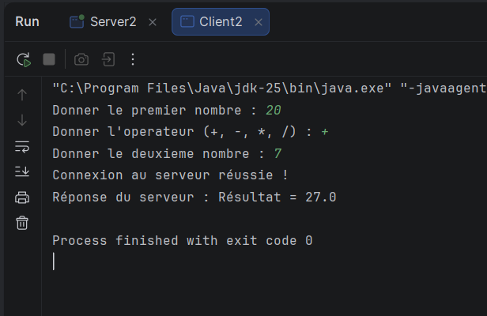

Client : 15 - 4 :

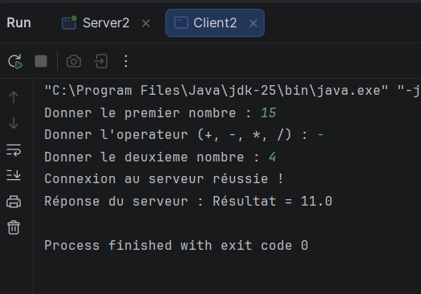

Console du serveur après trois opérations (compteur 1, 2, 3 avec des ports clients différents) :

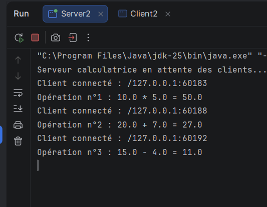

### 5.3 Tests avec plusieurs clients en parallèle

[Capture à insérer : trois instances de Client2 ouvertes en même temps]

[Capture à insérer : console de Server2 avec ports et threads différents]

### 5.4 Gestion de l'accès concurrent

Le compteur global est une ressource critique partagée par tous les threads ClientProcess2.

```java
private static int compteur = 0;

public static synchronized int incrementerCompteur() {
    compteur++;
    return compteur;
}
```

L'instruction compteur++ n'est pas atomique : elle se décompose en lecture, incrémentation puis écriture. Sans synchronisation, deux threads peuvent lire la même valeur et un incrément est perdu (situation de concurrence, ou race condition). Le mot-clé synchronized garantit qu'un seul thread à la fois exécute la méthode.

Test de charge : ClientTest lance 5 clients simultanés qui envoient chacun 10 opérations, soit 50 opérations attendues.

[Capture à insérer : console de ClientTest]

[Capture à insérer : fin du log de Server2 avec l'opération n°50]

### 5.5 Test en réseau local

[Capture à insérer : Client2 sur la deuxième machine]

[Capture à insérer : Server2 avec les opérations et l'adresse IP de la deuxième machine]

### 5.6 Synthèse

Le modèle un thread par client permet à plusieurs utilisateurs d'utiliser la calculatrice en même temps avec une communication indépendante pour chacun. Dès que des threads partagent une donnée modifiable, ici le compteur, l'accès doit être synchronisé. Le test de charge confirme que le compteur reste cohérent : la valeur finale est égale au nombre total d'opérations, sans doublon ni perte.

## 6. Difficultés rencontrées

| Difficulté | Solution |
|---|---|
| Telnet non reconnu sous Windows | Activation avec dism ou par le Panneau de configuration |
| Caractères accentués illisibles dans Telnet | chcp 65001 avant la commande telnet |
| Connexion refusée entre deux machines | Autoriser les ports 1234 et 1235 dans le pare-feu Windows, machines sur le même réseau |
| Serveur qui ferme la connexion juste après le premier message | Thread dédié par client et boucle de lecture dans ClientProcess |

## 7. Conclusion

Ce TP a permis de passer d'un serveur mono-client à un serveur multi-thread capable de traiter plusieurs clients simultanément, d'utiliser la communication par objets et de protéger une ressource partagée avec synchronized.
